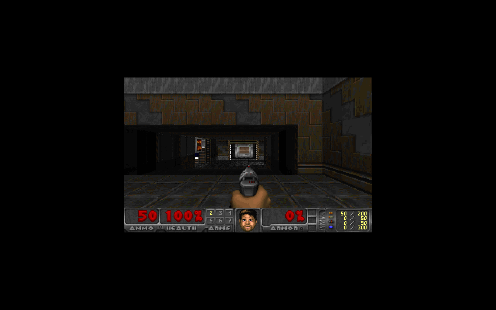

# Standalone Doom framebuffer proof

This documents a real QEMU framebuffer run using the official DoomGeneric
Linux VT backend and the Freedoom Phase 2 IWAD. It is a standalone validation
fixture. It does not exercise Megas' GUI, its guest-agent channel, or a product
button/QGA launch path.

The captured frame below came from QEMU's HMP `screendump` command while the
guest was rendering a live level. It is a PNG conversion of that capture; the
conversion was checked pixel-for-pixel against the original 1280x800 PPM.



## Inputs and provenance

The proof used Ubuntu 24.04 Noble `amd64` packages obtained through Ubuntu's
APT package archive and extracted into an isolated initramfs tree. Package
hashes are included so another run can use the same artifacts. The VM did not
use a prebuilt Doom image or a host-rendered frame.

| Input | Version / revision | SHA-256 |
| --- | --- | --- |
| Ubuntu `linux-image-6.8.0-31-generic` package | `6.8.0-31.31` | `fd2ed023c84163e62c73d3b7b613a9b004bd31e335641c23d42bd249e489fbe6` |
| Ubuntu `linux-modules-6.8.0-31-generic` package | `6.8.0-31.31` | `3f17f2c279257eb50e40da44390bdf8272c440ca078831c348773d1314b5c2fe` |
| Ubuntu `busybox-static` package | `1:1.36.1-6ubuntu3.1` | `944b2728f53ceb3916cec2c962873c9951e612408099601751db2a0a5d81e0ed` |
| Ubuntu `freedoom` package | `0.13.0-1` | `b7dd84233d088c2089f06764f2546ca68d663054799cc0df97ac1195eafa77ae` |
| Extracted kernel image | Ubuntu `6.8.0-31-generic` | `cee36e261749483e951c8229eb1aeeb768af6c28f493421a52b3916885ce913f` |
| Freedoom Phase 2 IWAD | `freedoom2.wad` | `5a9315fb7dedac6d11b42034d15b7f6828826b94c84c14078087fa4c97d88474` |
| DoomGeneric source | `ozkl/doomgeneric` commit `e257a09527062bfb986b6e5e0780839b6cbd5b71` | Linux VT source `2e76ff582626c5d480280501b4e23d2459c12809aec02a7b76aeefaf6c438d90` |
| Built DoomGeneric executable | Linux VT target | `c42e33a14161d196bcb5321da1731c0ad0b87545d537e9f5d53865a4483b5d66` |
| QEMU HMP raw capture | `1280x800` PPM | `c66a68baef368fe680677d23ba0159a63088133a34f6870476515ca4b379d5af` |

The DoomGeneric source repository is <https://github.com/ozkl/doomgeneric>
(GPL-2.0). The game data came from Ubuntu's `freedoom` package, not from a
proprietary Doom IWAD. For package acquisition, use Ubuntu's signed Noble APT
metadata (or an Ubuntu archive snapshot containing the exact versions above),
then verify the `.deb` hashes before extraction. `dpkg-deb -x` does not verify
archive signatures by itself; rely on APT's signed repository metadata for
that step.

## Reproduce

The commands below assume the package files have been downloaded from Ubuntu's
signed archive and placed in `$DEBS`, the checkout's QEMU test binary is at
`$QEMU`, and the QEMU support data/modules are available next to it. Keep the
guest tree isolated in `/tmp`; do not install these packages onto the host.

```sh
set -eu
REPO=$(git rev-parse --show-toplevel)
WORK=/tmp/megas-doom-proof
ROOT=$WORK/root
DEBS=/path/to/verified-ubuntu-debs
mkdir -p "$ROOT" "$WORK"

(
    cd "$DEBS"
    sha256sum -c <<'EOF'
fd2ed023c84163e62c73d3b7b613a9b004bd31e335641c23d42bd249e489fbe6  linux-image-6.8.0-31-generic_6.8.0-31.31_amd64.deb
3f17f2c279257eb50e40da44390bdf8272c440ca078831c348773d1314b5c2fe  linux-modules-6.8.0-31-generic_6.8.0-31.31_amd64.deb
944b2728f53ceb3916cec2c962873c9951e612408099601751db2a0a5d81e0ed  busybox-static_1%3a1.36.1-6ubuntu3.1_amd64.deb
b7dd84233d088c2089f06764f2546ca68d663054799cc0df97ac1195eafa77ae  freedoom_0.13.0-1_all.deb
EOF
)

for deb in "$DEBS"/linux-image-6.8.0-31-generic_6.8.0-31.31_amd64.deb \
           "$DEBS"/linux-modules-6.8.0-31-generic_6.8.0-31.31_amd64.deb \
           "$DEBS"/busybox-static_1%3a1.36.1-6ubuntu3.1_amd64.deb \
           "$DEBS"/freedoom_0.13.0-1_all.deb; do
    dpkg-deb -x "$deb" "$ROOT"
done
```

The minimal root also needs the Noble `libc6` runtime and `kmod` with its
runtime dependencies, extracted from the same signed archive, because the
Linux VT executable is dynamically linked to glibc and `/init` loads the
virtio GPU modules. Populate those packages in `$ROOT` with `dpkg-deb -x` as
well. No desktop, X server, SDL, EGL, Mesa, or sound server is needed for this
framebuffer backend. The test init source is
[`../tests/doom_proof_init.c`](../tests/doom_proof_init.c).

Build the official DoomGeneric Linux VT target at the pinned revision, then
copy it and the init into the isolated guest root:

```sh
git clone https://github.com/ozkl/doomgeneric.git "$WORK/doomgeneric"
git -C "$WORK/doomgeneric" checkout e257a09527062bfb986b6e5e0780839b6cbd5b71
make -j2 -C "$WORK/doomgeneric/doomgeneric" -f Makefile.linuxvt CC=gcc
mkdir -p "$ROOT/usr/local/bin" "$ROOT/usr/share/games/doom"
install -m 0755 "$WORK/doomgeneric/doomgeneric/doomgeneric" "$ROOT/usr/local/bin/doomgeneric"
gcc -static -O2 -Wall -Wextra -o "$ROOT/init" "$REPO/tools/megas/tests/doom_proof_init.c"
chmod 0755 "$ROOT/init"
```

The initramfs must contain the matching `6.8.0-31-generic` module tree under
`$ROOT/lib/modules`, the extracted userspace above, and the kernel image at
`$ROOT/boot/vmlinuz-6.8.0-31-generic`. Build it using the static BusyBox
`cpio` applet:

```sh
cd "$ROOT"
find . -xdev -print0 | ./bin/busybox cpio -o -H newc -0 | gzip -1 > "$WORK/initramfs.cpio.gz"
```

Boot with the QEMU binary and module directory built for this checkout. The
proof run used TCG, `virtio-vga`, a serial log, VNC display, and the HMP
monitor. When the guest reaches the level, enter `screendump` in the monitor,
then `quit`:

```sh
QEMU=/path/to/qemu-system-x86_64
QEMU_DATA=/path/to/qemu/share/qemu
QEMU_MODULES=/path/to/qemu/lib/qemu
LD_LIBRARY_PATH=/path/to/qemu/lib \
QEMU_MODULE_DIR="$QEMU_MODULES" \
"$QEMU" -L "$QEMU_DATA" -machine accel=tcg -cpu max -smp 1 -m 1024 \
  -kernel "$ROOT/boot/vmlinuz-6.8.0-31-generic" \
  -initrd "$WORK/initramfs.cpio.gz" \
  -append 'console=tty0 console=ttyS0 rdinit=/init' \
  -device virtio-vga -display vnc=127.0.0.1:28 \
  -serial file:"$WORK/serial.log" -monitor stdio -no-reboot
```

At the QEMU monitor prompt:

```text
screendump /tmp/megas-doom-proof/screen.ppm
quit
```

Check the serial and captured frame with the small stdlib-only verifier:

```sh
python3 "$REPO/tools/megas/tests/doom_proof_verify.py" \
  "$WORK/serial.log" "$WORK/screen.ppm"
```

The verifier requires kernel framebuffer initialization, the guest init and
DoomGeneric launch markers, Freedoom Phase 2, a 320x200 Doom framebuffer, and a
nonempty 1280x800 PPM capture. The run recorded those markers and rendered the
level shown above. The captured host proof image is
[`doom-proof.png`](doom-proof.png).

## Observed guest output

The serial log showed the `virtio_gpudrmfb` framebuffer, the guest init
launching DoomGeneric, `Freedoom: Phase 2`, and these graphics details:

```text
I_InitGraphics: framebuffer: x_res: 640, y_res: 400, ... bpp: 32
I_InitGraphics: framebuffer: RGBA: 8888, ...
I_InitGraphics: DOOM screen size: w x h: 320 x 200
I_InitGraphics: Auto-scaling factor: 2
```

This establishes a working standalone Linux framebuffer guest and actual
rendered game frame. It does not establish that the product's guest-agent
integration installs Doom, starts it, or transports its screen through the
Megas UI.
