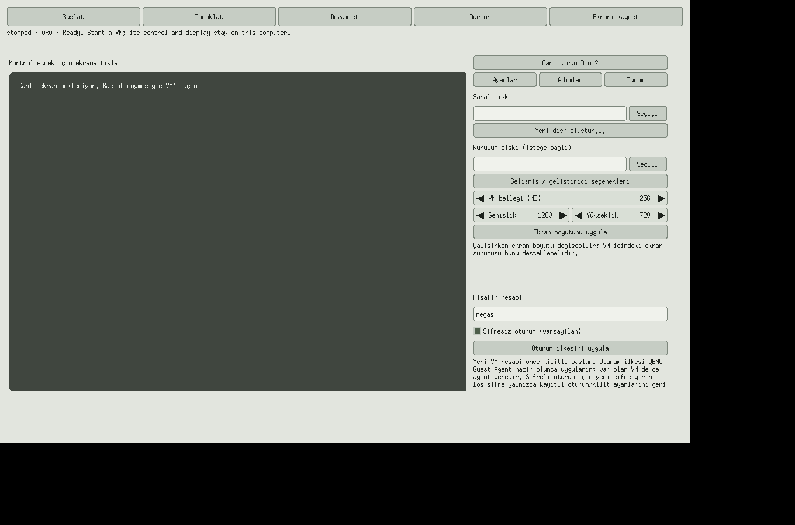

# Native GUI validation

`gui-proof.png` is a byte-for-byte copy of the final 1360×900 Xvfb root capture.
It preserves the full screen, including the 1180×760 Megas window at the top-left
and the unused Xvfb desktop around it. The native Linux/X11 application was run
with `LANG=tr_TR.UTF-8` and `LC_ALL=C.UTF-8`; the available Xvfb core font
rendered complete Turkish labels using transliteration, and the default username
appeared without trailing glyphs. The image was captured from the running
application; no UI content was added or redrawn.

In the default Settings view, disk, installation image, memory, resolution and
account controls remain visible. The QEMU executable selector is inside the
closed-by-default advanced/developer section; its help says the package selects
the program automatically. A GUI-input harness clicked Start and verified that
both the default executable and a package-provided `MEGAS_QEMU` path are preserved
in the start request. Expanding the advanced section exposes the selector.

This verifies Linux/X11 rendering under Xvfb only. The VM was stopped, so the
image does not show live guest pixels or verify guest-agent policy or Doom launch.
Native Windows Server 2022 window-launch evidence is recorded below; it does
not establish Windows 11 desktop behavior.

## Native Windows packaged GUI smoke — 2026-10-14, commit b7bdb815

In the [push Windows job
115654057480](https://github.com/void0x14/MegasXLR-qemu/actions/runs/38503004757/job/115654057480)
and [PR Windows job
115654068673](https://github.com/void0x14/MegasXLR-qemu/actions/runs/38503008393/job/115654068673)
for [commit
`b7bdb81500c222c8d878f46f9f3a5799a1542b15`](https://github.com/void0x14/MegasXLR-qemu/commit/b7bdb81500c222c8d878f46f9f3a5799a1542b15),
CI extracted the private bundle, ran its isolated installer and installed
command-line/QEMU/Tesseract checks, including the English trained-data file.
The installed `megas.exe` opened a native Windows window with title
`Megas · VM` and an HWND on each run. Its sampled working set was 14,860,288
bytes on push and 14,880,768 bytes on the PR run (14.2 MiB each).

The normal close request and bounded process wait completed, but both jobs
failed the following exit-code assertion because PowerShell returned a blank
`ExitCode`. The Windows bundle upload step was skipped, so these runs confirm
window creation and close activity on Windows Server 2022 but do not constitute
a passing packaged-GUI smoke test. They do not test a Windows 11 desktop or
include visual screenshot inspection. A later smoke-workflow change needs its
own CI result.
